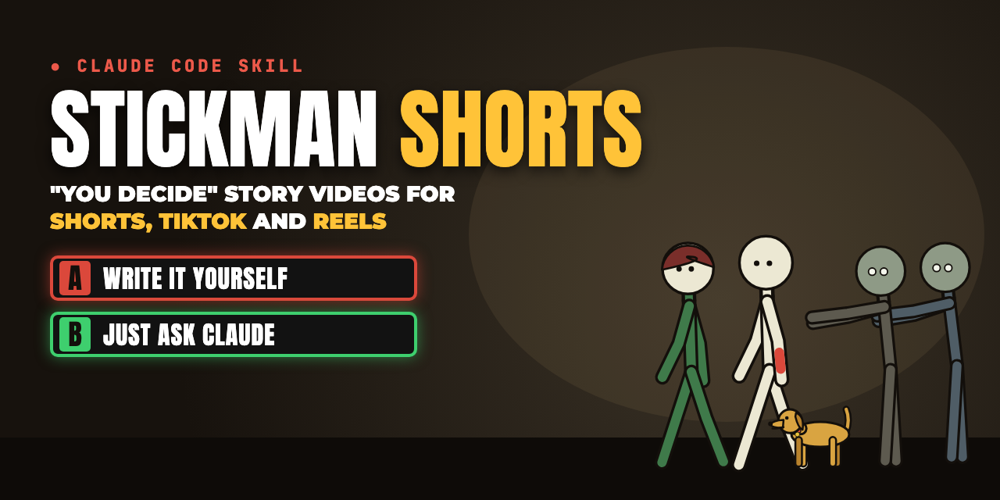
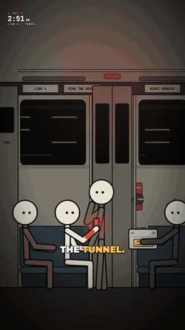
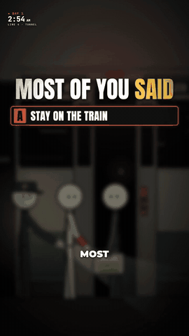
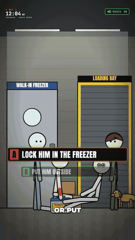
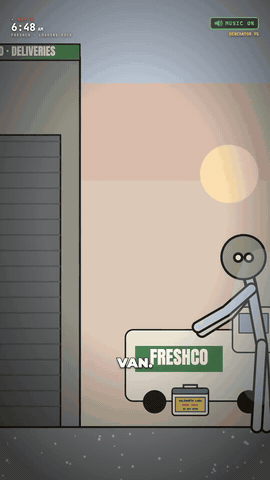
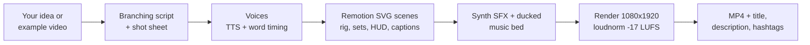

<div align="center">



# Stickman Shorts

**A Claude Code skill that writes, animates, voices and renders 2D stick-figure "You Decide" story shorts
for YouTube Shorts, TikTok and Instagram Reels, and clones the format of any video you show it.
Just tell Claude the story.**

[](https://docs.claude.com/en/docs/claude-code/skills)
[](https://www.remotion.dev)
[](LICENSE)
[](#example-videos)
[](https://www.youtube.com/@ForgottenEarthYT)
[](https://github.com/SyedBahjat/claude-stickman-shorts/stargazers)

   

**Every frame, voice, sound effect and note of music in these clips was made by this repo.**
Watch the full series live on YouTube: **[@ForgottenEarthYT](https://www.youtube.com/@ForgottenEarthYT)**

</div>

---

## What it does

You say: *"Make Part 1 of a zombie survival story set in a supermarket."*
Claude writes the branching script, casts the characters, builds the scenes, generates the voices, times
word-by-word captions, adds sound effects, renders a 1080×1920 MP4 and hands you the title, description and
hashtags. Viewers vote **A or B** in the comments; the next part opens with *"Most of you said…"* and continues
the winning path.

- **Story engine:** second-person survival stories with numbered rules, twists, and a hard A/B choice every part.
  Branching seasons are planned up front, so every path pays off.
- **Stick-figure rig:** flat SVG characters with IK hands and feet, distance-driven walk cycles (no foot sliding),
  props that stay in the hand, and a cast you extend in one line.
- **Ready-made sets:** bedroom, city skyline, stairwell, boiler room, bunker, subway train, tunnel, blast door,
  supermarket, back room, office, loading dock at dawn.
- **On-screen kit:** HUD with clock and countdown, TikTok-style word-synced captions with yellow keywords, rule
  cards, A/B choice cards, "Most of you said" opener, ending cards, camera push and shake, vignette, blur.
- **Voices that don't sound like AI:** any OpenAI-compatible TTS (free and local with VoiceStudio), best-of-N
  take picking, automatic word timing, and a clean audio chain with no time-stretch "robot" artifacts.
- **Copyright-free sound:** every SFX and music bed is synthesized from code, so there are no samples and no
  Content ID claims.
- **Clone any video format:** explainers, top-5 lists, story narrations, history facts, quizzes, chat stories,
  skits, kinetic text, whiteboard, horizontal long-form. Show it a video you like; it measures the cuts, pacing,
  palette, captions, loudness and sound design, then rebuilds that format with original content, in vertical,
  horizontal or square.

## Example videos

These are real episodes from the channel, rendered straight from this repo. Click a clip to watch it with sound.

| Series | Part | Video |
| --- | --- | --- |
| **Last Train** (subway blackout, Season 1) | Part 1: *the last train out* | [](examples/videos/lasttrain-p1.mp4) |
| | Part 2B: *follow the stranger* | [](examples/videos/lasttrain-p2b.mp4) |
| | Ending 3: *the lie* | [▶ lasttrain-p3a.mp4](examples/videos/lasttrain-p3a.mp4) |
| | Ending 4: *the truth* | [▶ lasttrain-p3b.mp4](examples/videos/lasttrain-p3b.mp4) |
| **FreshCo** (zombie outbreak in a supermarket) | Part 1: *trapped at closing time* | [](examples/videos/freshco-p1.mp4) |
| | Part 2B: *put him outside* | [](examples/videos/freshco-p2b.mp4) |

The scripts behind them, including every unchosen branch and a full Season 2, are in [`stories/`](stories).

## Quick start

### 1. Install the skill

**Option A: Claude Code plugin (recommended)**

```text
/plugin marketplace add SyedBahjat/claude-stickman-shorts
/plugin install stickman-shorts@claude-stickman-shorts
```

**Option B: clone the engine and work inside it** (the skill auto-loads from `.claude/skills/`)

```bash
git clone https://github.com/SyedBahjat/claude-stickman-shorts my-shorts
cd my-shorts && npm install
pip install -r requirements.txt   # numpy + scipy, for SFX and the reference analyzer
claude
```

**Option C: copy just the skill** into `~/.claude/skills/`:

```bash
git clone https://github.com/SyedBahjat/claude-stickman-shorts /tmp/sms && cp -r /tmp/sms/skills/stickman-shorts ~/.claude/skills/
```

With options A and C, the skill clones the engine for you the first time you ask for a video.

### 2. Requirements

- [Node.js](https://nodejs.org) 18+ and [ffmpeg](https://ffmpeg.org) on your PATH
- Python 3.10+ (only for new SFX and the reference analyzer)
- A text-to-speech voice source, any one of:
  - [VoiceStudio](https://github.com/debpalash/VoiceStudio): free, local, many engines, plus a Whisper endpoint
    to check the words. This is the default (`http://localhost:3900`).
  - Any OpenAI-compatible `/v1/audio/speech` server: set `TTS_URL`, `TTS_MODEL`, `TTS_API_KEY`.
  - ElevenLabs or your own recordings: export WAVs and pass `--from file.wav`.

### 3. Ask Claude

```text
Make Part 1 of a stickman "You Decide" survival short: a lighthouse keeper's last night before a storm.
```

```text
People voted B. Make Part 2 of FreshCo.
```

```text
Here's a short I like: ~/Downloads/example.mp4. Make our next series look and sound exactly like this,
with our own story.
```

```text
Make a 60-second explainer like this one, but about how black holes form: ~/Downloads/explainer.mp4
```

```text
Turn my blog post into a horizontal 5-minute YouTube video with a stick-figure host.
```

```text
Render all FreshCo parts vertical and give me YouTube + TikTok titles, descriptions and hashtags.
```

## Clone any video, not just "You Decide"

```bash
python scripts/analyze_reference.py ~/Downloads/example.mp4
```

It works on any type of video. This writes `reference/example/report.md` with the resolution, cut count, average shot length, loudness,
dominant palette (with hex values) and words per second, plus contact sheets, the first frame of every shot,
a spectrogram and a transcript. Claude reads all of it, fills the
[clone checklist](skills/stickman-shorts/references/CLONE-ANY-VIDEO.md), picks the matching recipe from the
[format catalog](skills/stickman-shorts/references/FORMATS.md), restyles palette, characters, captions and
cards, shows you a side-by-side still, then builds the video with **your own content**.

| Format | Format | Format |
| --- | --- | --- |
| You Decide stories | Explainers | Top-N / listicles |
| Narrated storytime | History / "this really happened" | Quizzes / would-you-rather |
| Dialogue skits / memes | Chat / text-message stories | Kinetic text / quotes |
| Whiteboard / doodle | Stats / comparisons | Horizontal YouTube long-form |

New formats start from [`src/templates/Starter.tsx`](src/templates/Starter.tsx), a template that renders in any
aspect ratio:

```bash
npx remotion render src/index.ts Starter out/starter.mp4 --props='{"format":"horizontal"}'   # or vertical / square
```

> Copy formats, not content. Don't re-upload other creators' videos, stories or audio.

## How it works



| Piece | Where |
| --- | --- |
| The skill (what Claude follows) | [`skills/stickman-shorts/SKILL.md`](skills/stickman-shorts/SKILL.md) + [`references/`](skills/stickman-shorts/references) |
| Stick-figure rig and cast | [`src/kit/Stick.tsx`](src/kit/Stick.tsx) |
| HUD, captions, cards, camera | [`src/kit/Overlays.tsx`](src/kit/Overlays.tsx), [`src/kit/ZombieHud.tsx`](src/kit/ZombieHud.tsx) |
| Sets | [`src/sets/`](src/sets) |
| Episodes | [`src/stories/`](src/stories), registered in [`src/Root.tsx`](src/Root.tsx) |
| Scripts, branches, continuity, voice notes | [`stories/`](stories) |
| Voice line + captions | [`scripts/voiceover.mjs`](scripts/voiceover.mjs) |
| Best-of-N voice takes | [`scripts/audio/voice_takes.py`](scripts/audio/voice_takes.py) |
| SFX and music synthesis | [`scripts/audio/`](scripts/audio) |
| Any-format starter template | [`src/templates/Starter.tsx`](src/templates/Starter.tsx) |
| Reference video analyzer | [`scripts/analyze_reference.py`](scripts/analyze_reference.py) |

## Commands

```bash
npm run dev                                                       # Remotion Studio: scrub every episode live
npx remotion still src/index.ts FreshCo-P2B out/f.png --frame=300 # one frame
npx remotion render src/index.ts FreshCo-P2B out/raw.mp4 --concurrency=6
ffmpeg -i out/raw.mp4 -c:v copy -af loudnorm=I=-17:TP=-1.5:LRA=11 -c:a aac -b:a 192k out/final.mp4
node scripts/voiceover.mjs fc3-01 "Most of you said: run." --voice <id> --trim --loud -16
npm run sfx                                                       # rebuild every sound effect
npm run typecheck
```

## FAQ

**Do I need a GPU or a paid API?** No. The video is SVG rendered by headless Chrome and the sounds are pure math.
The only model is the TTS, and VoiceStudio runs free on your own machine.

**Can I change the art style?** Yes. Palette tokens live in `src/kit/style.ts`; proportions, line width and face
live in `src/kit/Stick.tsx`. The copy-a-reference workflow walks Claude through changing them in order.

**Horizontal or square videos?** Yes. Start from the `Starter` template with `--props='{"format":"horizontal"}'`.
The rig, captions, camera and overlays scale to any size; the ready-made story sets are drawn for 9:16.

**Can it clone live-action or 3D videos?** It rebuilds their layout, pacing, text and sound as 2D animation.
It never reuses the original footage. You can drop your own clips or images into `public/` and use them.

**Will my uploads get copyright claims?** Not for the audio or art from this repo: it's all generated here.
Your voices are as safe as the TTS license you use.

**Why "You Decide"?** Comment voting turns viewers into co-writers, which drives comments, follows and
returning viewers for every next part.

## Roadmap

- [ ] More sets (hospital, forest cabin, school, spaceship)
- [ ] One-command "new story" scaffold
- [ ] Auto-generated title, description and thumbnail per part
- [ ] More HUD and caption themes

Ideas and PRs welcome: see [CONTRIBUTING.md](CONTRIBUTING.md).

## Support the project

If this saved you hours of animation, please **⭐ star the repo**. It helps other creators find it.
Watch the series and vote on what happens next: **[youtube.com/@ForgottenEarthYT](https://www.youtube.com/@ForgottenEarthYT)**

## License

[MIT](LICENSE) © Syed Bahjat. Example voices were generated with open TTS models; the art, music and sound
effects are original to this repo.
